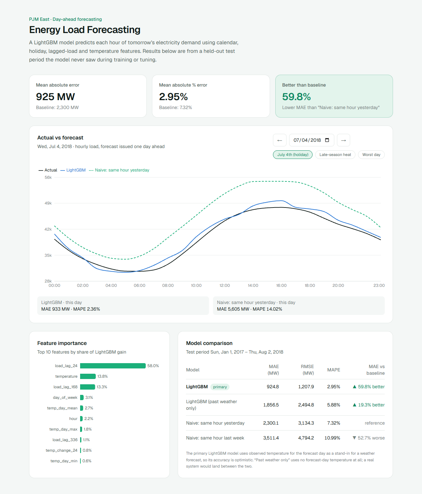
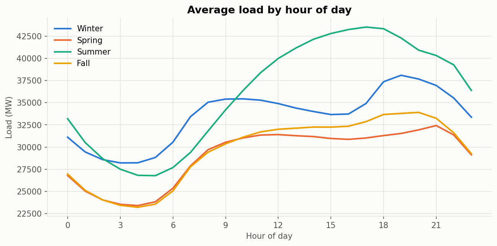
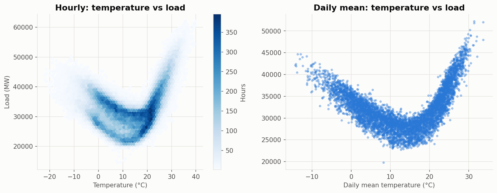
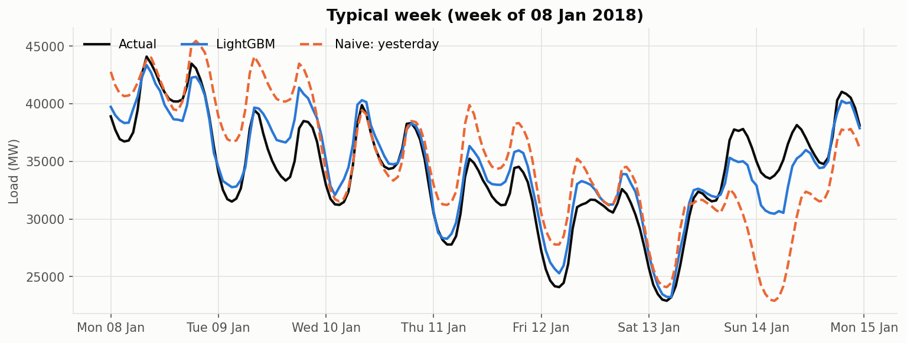
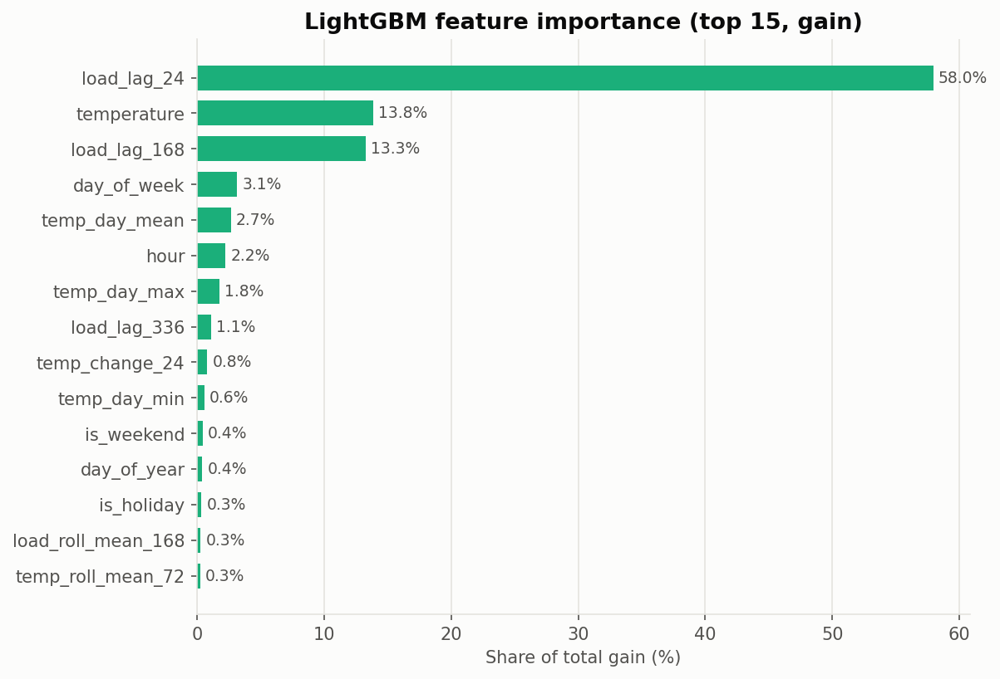
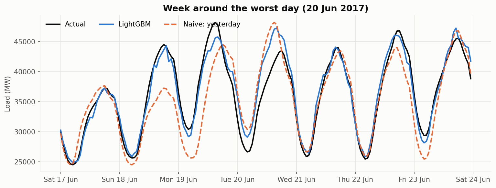

# Energy Load Forecasting

Day-ahead forecasting of hourly electricity demand for the PJM East region (US),
with a FastAPI backend and a Next.js dashboard that compares actual load with
model forecasts.



**Headline result:** on a held-out test period (Jan 2017 – Aug 2018), a LightGBM
model reaches **2.95% MAPE**, a **59.8% lower MAE** than the best naive baseline
(same hour yesterday, 7.32% MAPE). See [Limitations](#limitations) for what
this number does and does not mean.

---

## The problem

Grid operators commit generation a day in advance. Every morning they need a
forecast of each hour of the next day's demand: under-forecasting risks
shortages and expensive last-minute power, while over-forecasting wastes money
on idle capacity.

This project builds that **24-hour-ahead hourly forecast** and evaluates it
honestly against simple baselines, without letting future information leak
into the model.

## Data

| Source | What | Notes |
|---|---|---|
| [Hourly Energy Consumption](https://www.kaggle.com/datasets/robikscube/hourly-energy-consumption) (Kaggle) | `PJME_hourly.csv`, PJM East hourly load in MW, 2002-01-01 to 2018-08-03 | 145,366 rows; not redistributed, download it yourself |
| [Open-Meteo Historical Weather API](https://open-meteo.com/en/docs/historical-weather-api) | Hourly 2 m temperature for Philadelphia (39.95 N, 75.17 W) | Fetched once per year of data and cached locally |
| [`holidays`](https://pypi.org/project/holidays/) | US federal holidays | Used for holiday features |

**Data quality** (from `reports/data_quality.json`): no missing values, 4 duplicated
timestamps (averaged) and 30 missing hours (all short gaps, interpolated). Most
of these are daylight-saving artifacts, because the timestamps are local time.
Weather is downloaded in UTC and converted with the same local-time convention
so the two series line up. The final dataset has 145,392 hourly rows and no
missing temperatures.

## Approach

### 1. Exploratory analysis ([`notebooks/01_eda.ipynb`](notebooks/01_eda.ipynb))

| Daily cycle by season | Temperature vs load |
|---|---|
|  |  |

- Strong daily and weekly cycles: weekends are about 10% lower than mid-week.
- Summer peaks around 17:00 (about 43.5k MW). Winter has morning and evening peaks.
- Load is **U-shaped in temperature**: lowest near 15 °C, rising for heating
  (r = −0.85 below 15 °C) and cooling (r = +0.90 above). A single linear
  correlation (r = +0.17) hides this. This is why a tree model fits well.
- The 15 lowest-load hours all fall on 29–30 Oct 2012 (Hurricane Sandy). They
  were kept because they are real events, not data errors.

### 2. Time-based split

| Split | Period | Hours |
|---|---|---|
| Train | 2002-01-01 – 2015-12-31 | 122,711 |
| Validation | 2016 | 8,784 |
| Test | 2017-01-01 – 2018-08-02 | 13,896 |

The data is split by time only, never randomly. Validation is used for model
selection. The test set is scored once, at the end.

### 3. Baselines

- **Same hour yesterday** (`lag 24`)
- **Same hour last week** (`lag 168`)

### 4. Features and leakage control ([`src/features.py`](src/features.py))

| Group | Features |
|---|---|
| Calendar | hour, day of week, month, day of year, weekend flag |
| Holidays | is holiday, holiday yesterday, holiday last week |
| Lagged load | lags of 24, 48, 72, 168, 336 h; rolling means of 24 h and 168 h ending at t − 24 |
| Temperature | temperature, temperature 24 h ago, 24 h change, daily mean/max/min, 72 h rolling mean |

The forecast is issued a day ahead, so **every load-derived feature uses data at
least 24 hours old**. A unit test enforces this. It overwrites all load values
after t − 24 and asserts that the features at t do not change
([`tests/test_features.py`](tests/test_features.py)).

### 5. LightGBM

The search tries 20 random hyperparameter configurations. Each one is trained on
train with early stopping on validation. The best one is then refit on
train + validation and scored once on test
([`src/train_lightgbm.py`](src/train_lightgbm.py)). Validation MAPE across all
20 configurations ranged only from 2.69% to 2.75%. Features mattered far more
than hyperparameters.

## Results

All numbers below come from `reports/metrics.json`, produced by the pipeline.
Improvement is measured against the best baseline (same hour yesterday).

| Model | MAE (MW) | RMSE (MW) | MAPE | MAE vs baseline |
|---|---:|---:|---:|---:|
| **LightGBM** | **924.8** | **1,207.9** | **2.95%** | **59.8% better** |
| LightGBM, past weather only (ablation) | 1,856.5 | 2,494.8 | 5.88% | 19.3% better |
| Naive: same hour yesterday | 2,300.1 | 3,134.3 | 7.32% | reference |
| Naive: same hour last week | 3,511.4 | 4,794.2 | 10.99% | 52.7% worse |

| A typical week | Feature importance |
|---|---|
|  |  |

**What drives the model:** `load_lag_24` accounts for 58.0% of total gain,
followed by `temperature` (13.8%) and `load_lag_168` (13.3%). In effect the
model learns "yesterday's load, corrected for weather and weekly pattern".

### Where it fails

| Segment (test) | Days | LightGBM MAPE | Yesterday baseline MAPE |
|---|---:|---:|---:|
| Weekday | 385 | 2.90% | 6.56% |
| Weekend | 162 | 3.00% | 8.91% |
| Day after holiday | 15 | 2.89% | 8.37% |
| **Holiday** | 17 | **3.69%** | 8.52% |
| Hot day (max ≥ 32 °C) | 22 | 2.94% | 8.15% |
| Cold day (min ≤ −10 °C) | 12 | 2.74% | 4.78% |

- **Holidays** remain the weakest segment. Memorial Day 2018 is the
  2nd-worst day (9.03%).
- **Worst day, 20 Jun 2017 (9.50%):** Philadelphia's max temperature barely
  changed from the day before (28.6 → 29.0 °C), but actual load dropped about 9%.
  The model followed yesterday's level. A single weather point cannot see
  conditions across the rest of the region.
- **Late-season heat, 21–23 Sep 2017:** an unusual September heat spell (30–33 °C).
  The model over-forecast by about 2,000 MW for several days, likely because hot
  days in training are almost all mid-summer, when load is higher.
- Error is lowest overnight (~2.5%) and highest in the afternoon, 13:00–16:00 (~3.7%).



## Limitations

1. **Observed temperature instead of a weather forecast.** The main model uses
   the *actual* temperature of the forecast day as a stand-in for a perfect
   weather forecast, so 2.95% MAPE is optimistic. To bound the effect, an
   ablation model uses no forecast-day temperature at all and gets
   **5.88% MAPE**. A real system using day-ahead weather forecasts would land
   between the two. The exact value has not been measured here.
2. **One weather location for a multi-state region.** PJM East covers several
   states. Philadelphia alone misses regional weather differences (see the
   worst day above).
3. **One holiday flag.** Christmas and Columbus Day are treated the same, even
   though their effect on load is very different.
4. **Static test-period results.** The API serves precomputed predictions for
   2017–2018. It does not produce live forecasts for tomorrow.
5. **Old data.** The dataset ends in August 2018. Load patterns since then
   (behind-the-meter solar, electrification, post-2020 work patterns) may differ.
6. **Point forecasts only.** There are no prediction intervals.
7. **Single test window.** Results come from one 19-month test period rather
   than a rolling-origin backtest.

## Future work

- Train and evaluate on archived **weather forecasts** (e.g. the Open-Meteo
  Historical Forecast API) to measure realistic accuracy.
- Use **several population-weighted weather stations** across the region, plus
  humidity and other variables.
- **Holiday-specific features** (holiday type, bridge days) and an explicit
  "unseasonal heat" signal.
- **Probabilistic forecasts** with quantile regression (P10/P50/P90).
- **Rolling-origin backtesting** for more robust error estimates.
- A daily batch job that retrains and publishes tomorrow's forecast, with
  drift monitoring.

## Project structure

```
data/                 raw/ (Kaggle CSV), external/ (weather cache), processed/  [git-ignored]
notebooks/01_eda.ipynb
src/                  data pipeline, features, models, analysis
  build_dataset.py    load + clean + merge weather       -> data/processed/
  run_baselines.py    naive baselines
  train_lightgbm.py   tuning, refit, test evaluation      -> models/  [git-ignored]
  run_analysis.py     comparison, importance, error analysis -> reports/
  export_api_artifacts.py                                 -> api/artifacts/
api/                  FastAPI service (serves api/artifacts only)
web/                  Next.js dashboard
tests/                pytest suite (pipeline + API)
reports/              metrics, analysis JSON, figures
scripts/              notebook generator
```

## Run locally

Requirements: Python 3.11, Node.js 20+.

```bash
# 1. Python environment
python -m venv .venv
.venv\Scripts\activate            # Windows  (macOS/Linux: source .venv/bin/activate)
pip install -r requirements.txt

# 2. Data: download PJME_hourly.csv from Kaggle into data/raw/

# 3. ML pipeline (each step writes files the next one reads)
python -m src.build_dataset                       # fetches + caches weather on first run
python -m src.run_baselines
python -m src.train_lightgbm
python -m src.train_lightgbm --variant past_weather
python -m src.run_analysis
python -m src.export_api_artifacts

# 4. Tests
python -m pytest

# 5. API  ->  http://localhost:8000/docs
uvicorn api.main:app --reload

# 6. Dashboard  ->  http://localhost:3000
cd web
cp .env.example .env.local        # NEXT_PUBLIC_API_URL=http://localhost:8000
npm install
npm run dev
```

The API and dashboard work without the Kaggle data, because `api/artifacts/`
is committed. Steps 2–3 are needed only to rebuild the model.

### API

| Endpoint | Returns |
|---|---|
| `GET /metrics` | Test metrics and % improvement over the baseline for all models, plus the test period |
| `GET /forecast?date=YYYY-MM-DD` | Actual load and every model's prediction for the 24 hours of a test day, plus that day's MAE/MAPE |
| `GET /feature-importance` | Gain importance (%) of the main LightGBM model |
| `GET /health` | Liveness check |

## Deployment

**Backend → Render (free)**
1. Push the repo to GitHub.
2. In Render, choose **New → Blueprint** and select the repo. It reads
   [`render.yaml`](render.yaml), which installs only `api/requirements.txt` and
   runs `uvicorn api.main:app`.
3. Set `ALLOWED_ORIGINS` to your Vercel URL (comma-separated if more than one).
4. Check `https://<service>.onrender.com/health`. Free instances sleep when
   idle, so the first request can take up to about a minute.

**Frontend → Vercel**
1. Import the repo in Vercel and set **Root Directory** to `web`.
2. Add the environment variable `NEXT_PUBLIC_API_URL=https://<service>.onrender.com`.
   It is inlined at build time, so redeploy after changing it.
3. Deploy, then make sure the Vercel URL is listed in Render's `ALLOWED_ORIGINS`.

## Tech stack

Python · pandas · LightGBM · scikit-learn · matplotlib · FastAPI · pytest ·
Next.js (App Router) · TypeScript · Tailwind CSS · Recharts
